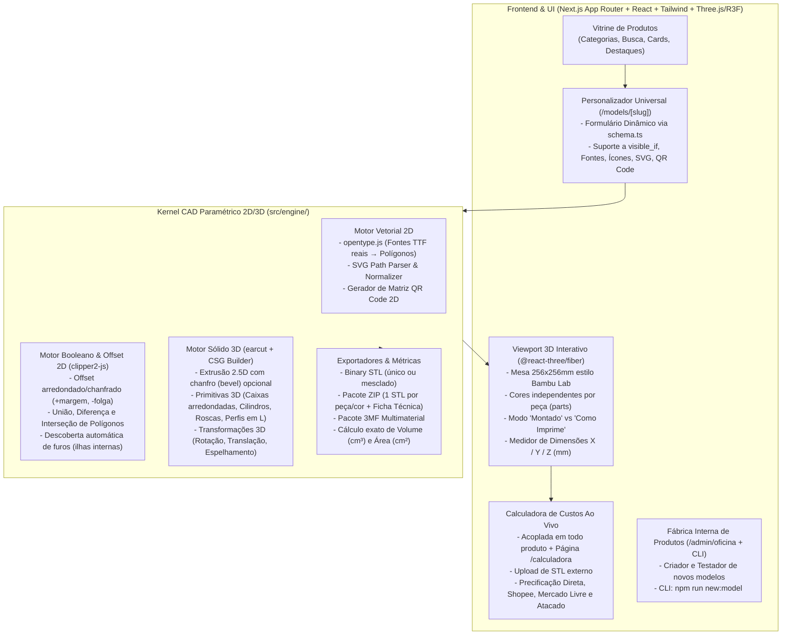

# Plano de Implementação & Engenharia Reversa — Plataforma `STLTools`

> **Documento vivo de Arquitetura, Engenharia Reversa e Plano de Execução.**
> Salvo na raiz do repositório (`/PLAN.md`) para consulta, evolução e documentação de todas as decisões de produto e engenharia.

---

## Parte 1: Síntese da Engenharia Reversa (`usestl.com`)

Antes de projetarmos o `STLTools`, realizamos a engenharia reversa completa da plataforma de referência (`usestl.com`):

1. **O Segredo do Catálogo Paramétrico (246 Modelos)**:
   - O catálogo deles não usa IA generativa para criar chaveiros, letreiros, placas, suportes ou cortadores. Ele usa **Geometria Paramétrica / CSG determinística**.
   - Cada produto do catálogo é definido por um **Schema JSON declarativo** (`id`, `name`, `description`, `categories`, `credit_cost`, `params` com suporte a `visible_if`, e `parts` para separar peças por cor).
   - O formulário na tela é **100% gerado automaticamente** a partir desse JSON — adicionar um produto novo não exige mexer em nenhuma linha de código de interface (React).
   - A geração da malha 3D baseia-se em **5 super-operações geométricas**:
     1. **Texto 2D (`text`)**: Renderização de strings em fontes TrueType/OpenType (`.ttf`).
     2. **Importação de SVG/Ícones (`svg`)**: Vetores 2D normalizados em milímetros.
     3. **Offset Poligonal 2D (`offset(r)`)**: A operação mais importante! Expandir (`+r`) cria a base contornada de chaveiros e topos de bolo; subtrair dois offsets (`offset(r+parede) - offset(r)`) cria a lâmina de cortadores de biscoito e paredes de letra-caixa; expandir com `+folga` (`0.25mm`) cria rebaixos para encaixe de peças coloridas sem cola!
     4. **Extrusão Linear / Revolução (`linear_extrude`)**: Transforma os polígonos 2D em sólidos 3D fechados (*watertight*).
     5. **Separação por Peça (`parts`)**: O gerador retorna múltiplas malhas nomeadas (ex: `corpo` + `nome` + `logo`). O visualizador 3D pinta cada peça da cor escolhida pelo usuário e exporta um `.STL` único, um `.ZIP` com um STL por cor, ou um `.3MF` multimaterial.

2. **A Calculadora de Custos 3D**:
   - Calcula o **Volume Real ($\text{cm}^3$)** (via soma do produto misto / volume assinado dos tetraedros de cada triângulo da malha) e a **Área Superficial ($\text{cm}^2$)**.
   - Estima o peso real separando a **Casca Externa** ($\text{Área} \times \text{Espessura das Paredes}$) do **Miolo Interno** ($\text{Volume Interno} \times \text{Infill \%}$), multiplicado pela densidade do polímero ($\text{PLA} = 1,24\text{ g/cm}^3$, $\text{PETG} = 1,27$, $\text{ABS} = 1,04$, $\text{TPU} = 1,21$).
   - Compõe o preço somando: Filamento + Energia Elétrica (kWh × Potência da Impressora) + Depreciação/Manutenção + Taxa de Falha + Embalagem/Acessórios + Comissões de Marketplace (Shopee / Mercado Livre) + Margem de Lucro.

---

## Parte 2: Arquitetura da Nossa Plataforma (`STLTools`)

Escolhemos uma arquitetura moderna, rápida, 100% autocontida em TypeScript (Next.js App Router) que **não depende de processos externos lentos no sistema operacional** para gerar malhas 3D, permitindo preview instantâneo no navegador e escalabilidade com custo quase zero de servidor.

---

## Parte 3: Catálogo Inicial de Produtos Paramétricos (MVP)

Todos os produtos residem em `src/models/<slug>/` seguindo a arquitetura da nossa **Fábrica Interna de Produtos**:

1. **`suporte-celular-marca` (Suporte de Mesa para Celular Personalizado — Sua Marca)** ⭐
   - **Estilos**: Clássico Inclinado em L (com nervura traseira), Bloco Executivo Minimalista, ou Encaixe em X (2 peças planas desmontáveis).
   - **Personalização**: Texto/Marca customizável + Fonte + Logo SVG/Imagem (em Alto-Relevo colorido, Baixo-Relevo entalhado ou Vazado).
   - **Ergonomia**: Largura, Altura do encosto, Ângulo de inclinação (15°–45°), Vão para capinha (9–20mm), Aba frontal, Passagem para cabo carregador USB-C e alternância entre vista *Montado* e *Como Imprime*.
2. **`chaveiro-suporte-celular` (Chaveiro Suporte de Celular de Bolso)** ⭐
   - Suporte portátil de bolso com argola de chaveiro, rasgo angulado calibrado para apoiar o smartphone na mesa, abridor lateral opcional e nome/marca em duas cores.
3. **`chaveiro-contorno` (Chaveiro Personalizado Duas Cores com Contorno Automático)**
   - Geração automática de "bolha" contornada (`offset`) ao redor de qualquer nome (1 ou 2 linhas) + ícone da galeria ou SVG próprio, borda opcional e 4 estilos de argola.
4. **`letra-com-nome` (Letra Inicial Grande + Nome Entrelaçado Sem Cola)**
   - Letra capitular espessa que fica em pé sozinha na mesa + nome atravessado na frente com rebaixo automático calibrado por `folga` (`0.15mm` a `0.40mm`) para encaixe perfeito sem cola.
5. **`letreiro-3d-mesa` (Gerador de Nome 3D de Mesa & Topo de Bolo)**
   - Nome 3D com fundo contornado + opção de Base Pedestal de Mesa ou Hastes pontiagudas para **Topo de Bolo**.
6. **`letra-caixa-led` (Letra-Caixa Luminosa com Tampa e Ficha Técnica)**
   - Corpo oco com paredes configuráveis, furos traseiros para fita LED/parafusos e tampa frontal com encaixe rebaixado (`folga`), gerando cálculo automático de perímetro de fita LED.
7. **`cortador-carimbo` (Fábrica de Cortadores de Biscoito, Argila e Carimbos)**
   - Gera Cortador com lâmina fina chanfrada + aba de pressão ergonômica (flange) + Carimbo Marcador com pegador a partir de formas da galeria, texto ou SVG do usuário.
8. **`placa-personalizada` (Placa de Porta, Escritório, QR Code Pix & Wi-Fi)**
   - Placa retangular/arredondada com moldura, furos de fixação ou dupla-face, título, subtítulo e gerador integrado de **QR Code 3D escaneável pela câmera do celular**.
9. **`tag-pet` (Tag de Identificação Pet — Osso, Coração, Círculo e Escudo)**
   - Pingente de coleira com nome do pet em destaque e telefone de contato gravado/relevo.

---

## Parte 4: Documentação de Processos e Ideias Evolutivas

Para garantir que nossa operação cresça de forma organizada e possamos alterar processos no futuro sem reescrever o sistema, criaremos e manteremos na pasta `/docs/`:

1. **[`/docs/PRODUCT_FACTORY_WORKFLOW.md`](file:///home/joao/Documents/www/stltools/docs/PRODUCT_FACTORY_WORKFLOW.md)**:
   - Manual passo a passo de como funciona a criação interna de novos modelos de produtos (usando o gerador CLI `npm run new:model`, a oficina visual `/oficina`, prompts prontos para pedir novos modelos para IA e a referência completa da API de Super-Primitivas 2D/3D).
2. **[`/docs/PROCESS_AND_IDEAS.md`](file:///home/joao/Documents/www/stltools/docs/PROCESS_AND_IDEAS.md)**:
   - Documento vivo de "Ideias de Processo & Decisões de Negócio/Engenharia" (como funciona a fórmula de cálculo de custos e como calibrá-la, pipeline de adição de fontes e ícones, estratégias de monetização/créditos vs. assinatura, SEO programático de templates, geração de imagens de capa e roadmap de evolução).
